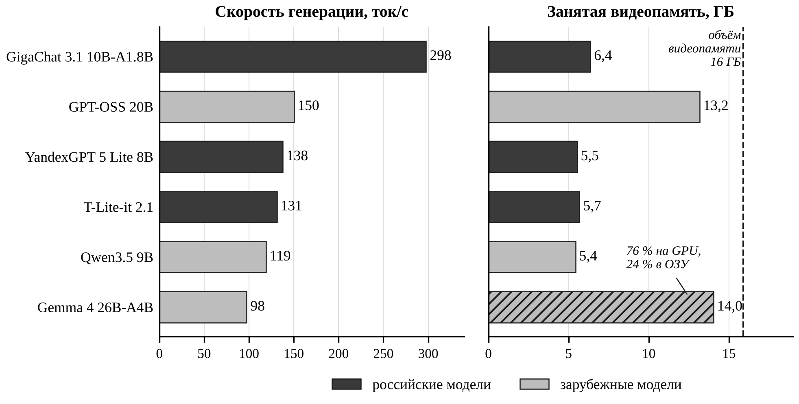

# Локальные языковые модели на рабочей станции магистранта

Материалы для воспроизведения эксперимента из статьи:

> Евдокимов И. Д. Инструменты искусственного интеллекта в учебно-исследовательской деятельности магистранта: методологический подход и сравнительный анализ (раздел 3 «Локальные языковые модели: эксперимент на рабочей станции»). Научный руководитель – Кулантаева И. А., ФГБОУ ВО «Оренбургский государственный университет», 2026.

Эксперимент отвечает на вопрос: **какие открытые языковые модели магистрант может реально использовать на собственном компьютере без сервера** и как они справляются с типовыми задачами подготовки диссертации. Сравниваются шесть моделей (три российские, три зарубежные) по двум блокам:

1. **Технические метрики**: скорость генерации и обработки запроса, время до первого токена, занятая видеопамять, максимальный контекст без выгрузки в оперативную память.
2. **Качество ответов** на пять типовых задач магистранта, оценённое по формализованным критериям (0–2 балла за задачу), с проверкой каждой названной моделью ссылки на существование.

Всё запускается на Windows через [Ollama](https://ollama.com) и PowerShell-скрипты. Никаких дополнительных программ, кроме Ollama и драйвера видеокарты, не требуется.

---

## Содержание

- [Итоговые результаты](#итоговые-результаты)
- [Структура репозитория](#структура-репозитория)
- [Требования](#требования)
- [Пошаговое воспроизведение](#пошаговое-воспроизведение)
- [Как устроены скрипты](#как-устроены-скрипты)
- [Как считаются метрики](#как-считаются-метрики)
- [Оценка качества](#оценка-качества)
- [Известные проблемы и как они решены](#известные-проблемы-и-как-они-решены)
- [Воспроизведение на другом оборудовании](#воспроизведение-на-другом-оборудовании)
- [Лицензия и цитирование](#лицензия-и-цитирование)

---

## Итоговые результаты

Стенд: AMD Ryzen 9 9950X, NVIDIA GeForce RTX 5070 Ti 16 ГБ, 32 ГБ DDR5 (4800 МТ/с), Windows 11 Pro 25H2, Ollama 0.40.3, драйвер NVIDIA 591.86 (CUDA 13.1). Дата: 12.10.2026.

### Технические характеристики

| Модель | Разработчик | Параметры, млрд (всего / активных) | Файл весов, ГБ | Видеопамять, ГБ | Генерация, ток/с | Обработка запроса, ток/с | До 1-го токена, с | Контекст без выгрузки, тыс. ток. |
|---|---|---|---|---|---|---|---|---|
| GigaChat 3.1 10B-A1.8B | Сбер | 10 / 1,8 | 6,0 | 6,4 | 298 | 9 311 | 0,48 | ≥ 128 |
| YandexGPT 5 Lite 8B | Яндекс | 8 / 8 | 4,6 | 5,5 | 138 | 6 945 | 0,45 | 32 (предел модели) |
| T-Lite-it 2.1 | Т-Технологии | 8 / 8 | 4,7 | 5,7 | 131 | 6 777 | 0,51 | ≈ 40 (предел модели) |
| Qwen3.5 9B | Alibaba | 9 / 9 | 5,2* | 5,4 | 119 | 5 439 | 0,74 | ≥ 128 |
| GPT-OSS 20B | OpenAI | 21 / 3,6 | 12,9 | 13,2** | 150 | 9 212 | 0,44 | 64 |
| Gemma 4 26B-A4B | Google | 25,2 / 3,8 | 15,9* | 14,0** (76 % модели) | 98 | 3 006 | 1,28 | не помещается |

Контекст 8192 токена; генерация, обработка и время до первого токена — медиана трёх повторов для запроса объёмом 3–4 тыс. токенов. 1 ГБ = 2³⁰ байт. \* Без модуля обработки изображений. \*\* По данным драйвера (`nvidia-smi`) за вычетом фона 1,4 ГБ: Ollama для этих двух моделей сообщает неверный объём (см. [проблему 5](#5-ollama-неверно-сообщает-занятую-память-для-части-моделей)).



### Качество ответов (0–2 балла за задачу)

| Модель | 1. Научный аппарат | 2. Реферирование | 3. ГОСТ | 4. Объяснение метода | 5. Подбор источников | Сумма из 10 | Несуществующих ссылок |
|---|---|---|---|---|---|---|---|
| GigaChat 3.1 10B-A1.8B | 2 | 2 | 0 | 1 | 0 | 5 | 5 из 5 |
| YandexGPT 5 Lite 8B | 2 | 1 | 1 | 1 | 2 | 7 | 0 (отказ) |
| T-Lite-it 2.1 | 2 | 2 | 0 | 0 | 0 | 4 | 5 из 5 |
| Qwen3.5 9B | 2 | 1 | 0 | 2 | 1 | 6 | 5 из 5 |
| GPT-OSS 20B | 1 | 1 | 0 | 2 | 1 | 5 | 5 из 5 |
| Gemma 4 26B-A4B | 2 | 2 | 1 | 2 | 1 | 8 | 1 из 5 |

Обоснование каждого балла — в `results/scores_and_results.xlsx` (лист «Качество»), проверка каждой ссылки — на листе «Ссылки З5».

### Главное

- Все модели до 21 млрд параметров помещаются в 16 ГБ видеопамяти и работают в интерактивном режиме (119–298 ток/с).
- Скорость определяется числом **активных** параметров, а не общим размером: GigaChat (MoE, 1,8 млрд активных) вдвое быстрее плотных моделей на 8–9 млрд; GPT-OSS при 13 ГБ памяти быстрее моделей на 5,5 ГБ.
- Выгрузка части модели в ОЗУ (Gemma 4) почти не замедляет генерацию, но в 2–3 раза замедляет чтение длинного запроса.
- Длинный контекст (128 тыс. токенов) в 16 ГБ держат только модели с экономной архитектурой внимания (GigaChat, Qwen3.5): ~0,03 ГБ на 1 тыс. токенов против ~0,13 ГБ у YandexGPT и T-Lite.
- **21 из 25 названных моделями источников не существует.** Единственная модель без выдуманных ссылок — YandexGPT, честно отказавшаяся их называть.

---

## Структура репозитория

```
local-llm-masters-benchmark/
├── README.md                 этот файл
├── LICENSE                   лицензия MIT
├── models.csv                список моделей: имя; тег Ollama; формат диалога
├── common.ps1                общие функции (запросы к API Ollama, замер видеопамяти, медиана)
├── 01_pull_models.ps1        шаг 1: загрузка моделей
├── 02_bench.ps1              шаг 2: технические метрики
├── 03_quality.ps1            шаг 3: ответы моделей на пять задач
├── bench/
│   ├── short_prompt.txt      короткий запрос для замера скорости
│   └── long_context.txt      длинный текст (~16,5 тыс. символов) для замера обработки запроса
├── tasks/
│   ├── task1.txt … task5.txt пять типовых задач магистранта
│   └── abstract_en.txt       англоязычная аннотация для задачи 2
├── docs/
│   ├── criteria.md           критерии оценки 0/1/2 с эталонами
│   └── experiment_log.md     журнал эксперимента: что пошло не так и как исправлено
├── answers/<модель>/         ответы моделей (task1.md … task5.md, ALL.md; рассуждения — в свёрнутых блоках)
├── results/
│   ├── summary/              сводные данные, использованные в статье (CSV)
│   ├── raw/                  место для сырых CSV ваших прогонов
│   ├── scores_and_results.xlsx  оценки с обоснованием, проверка ссылок, технические данные
│   └── scores_template.xlsx  пустой шаблон для собственной оценки
└── analysis/
    ├── plot_speed_vram.py    построение рисунка по results/summary/tech_summary_all.csv
    └── fig_speed_vram.png    рисунок 2 статьи
```

---

## Требования

| Компонент | Что нужно | Как проверить |
|---|---|---|
| ОС | Windows 10/11 (скрипты рассчитаны на Windows PowerShell 5.1, входящий в систему) | — |
| Видеокарта | NVIDIA с 8+ ГБ видеопамяти; для полной выборки — 16 ГБ | `nvidia-smi` |
| Драйвер | Для RTX 50-й серии — 570 и новее (CUDA 12.8+) | строка `Driver Version` в `nvidia-smi` |
| Ollama | Актуальная версия (Gemma 4 и Qwen3.5 требуют версий 2026 года) | `ollama --version` |
| Диск | ~55 ГБ под модели | — |
| Python (необязательно) | 3.9+ и `matplotlib` — только для перестроения рисунка | `python --version` |

---

## Пошаговое воспроизведение

Все команды выполняются в PowerShell в папке репозитория.

### Шаг 0. Подготовка

1. Установите Ollama: <https://ollama.com/download/windows>. После установки она запускается сама (значок в трее).
2. Если на диске C мало места, **до загрузки моделей** задайте папку для них переменной среды пользователя `OLLAMA_MODELS` (например, `D:\ollama\models`) и перезапустите Ollama.
3. Скачайте репозиторий (`Code → Download ZIP` или `git clone`) и откройте PowerShell в его папке.
4. Разрешите выполнение скриптов для текущего окна:
   ```powershell
   Set-ExecutionPolicy -Scope Process -ExecutionPolicy Bypass
   ```
5. **Закройте программы, использующие видеокарту**: анимированные обои (Wallpaper Engine), браузеры, Discord, Steam, Figma, Telegram и т. п. В нашем случае они занимали ~4 ГБ видеопамяти и снижали скорость генерации в разы. Без моделей в видеопамяти должно оставаться ≲1,5 ГБ:
   ```powershell
   nvidia-smi --query-gpu=memory.used,memory.total --format=csv
   ```

### Шаг 1. Загрузка моделей

```powershell
.\01_pull_models.ps1
```

Скрипт выполняет `ollama pull` для каждой строки `models.csv`. Используемые модели:

| Модель | Тег Ollama | Источник |
|---|---|---|
| GigaChat 3.1 10B-A1.8B | `hf.co/ai-sage/GigaChat3.1-10B-A1.8B-GGUF:Q4_K_M` | [Hugging Face](https://huggingface.co/ai-sage/GigaChat3.1-10B-A1.8B-GGUF) |
| YandexGPT 5 Lite 8B | `hf.co/yandex/YandexGPT-5-Lite-8B-instruct-GGUF:Q4_K_M` | [Hugging Face](https://huggingface.co/yandex/YandexGPT-5-Lite-8B-instruct-GGUF) |
| T-Lite-it 2.1 | `hf.co/t-tech/T-lite-it-2.1-GGUF:Q4_K_M` | [Hugging Face](https://huggingface.co/t-tech/T-lite-it-2.1-GGUF) |
| Qwen3.5 9B | `qwen3.5:9b` | [Ollama Library](https://ollama.com/library/qwen3.5) |
| GPT-OSS 20B | `gpt-oss:20b` | [Ollama Library](https://ollama.com/library/gpt-oss) |
| Gemma 4 26B-A4B | `gemma4:26b` | [Ollama Library](https://ollama.com/library/gemma4) |

Проверка: `ollama list` должна показать все шесть моделей.

### Шаг 2. Технические метрики

Запускайте модели по одной (так проще заметить ошибку, а результаты каждой попадут в отдельные файлы):

```powershell
.\02_bench.ps1 -Only GigaChat
.\02_bench.ps1 -Only Yandex
.\02_bench.ps1 -Only T-Lite
.\02_bench.ps1 -Only Qwen
.\02_bench.ps1 -Only GPT-OSS
.\02_bench.ps1 -Only Gemma
```

Параметр `-Only` — часть имени модели из `models.csv`; без него прогоняются все модели. `-Repeats N` задаёт число повторов (по умолчанию 3). Время: 3–5 минут на модель, для Gemma — до 15.

Во время замера компьютер лучше не трогать. Результаты — в `results\`:

| Файл | Содержимое |
|---|---|
| `tech_raw_<модель>.csv` | каждый прогон: число токенов запроса и ответа, скорости, время до первого токена |
| `tech_summary_<модель>.csv` | медианы, объём модели в памяти, доля на GPU, пик видеопамяти по драйверу, максимальный контекст |
| `context_<модель>.csv` | объём памяти модели при контексте 4K…128K и признак «целиком на GPU» |
| `gpu_<модель>.txt` | показания `nvidia-smi` с шагом 250 мс |

После всех моделей измерьте фон видеопамяти без моделей — он нужен для пересчёта (см. [проблему 5](#5-ollama-неверно-сообщает-занятую-память-для-части-моделей)):

```powershell
ollama ps            # список должен быть пустым; иначе: ollama stop <модель>
nvidia-smi --query-gpu=memory.used,memory.total --format=csv
```

### Шаг 3. Ответы на пять задач

```powershell
.\03_quality.ps1
```

Ответы сохраняются в `answers\<модель>\task1.md … task5.md` и общим файлом `ALL.md`. Если у модели появилось сообщение `<-- ПУСТОЙ ОТВЕТ`, задачу можно перезапустить отдельно:

```powershell
.\03_quality.ps1 -Only Qwen -Tasks 2,3,5
```

Время: от 1 минуты (GigaChat) до ~5 минут на модель с рассуждениями (Qwen3.5, GPT-OSS, Gemma 4).

### Шаг 4. Оценка ответов

1. Откройте `results\scores_template.xlsx` и `docs\criteria.md`.
2. Оценивайте **одну задачу у всех моделей подряд**, а не одну модель по всем задачам — так шкала держится ровнее.
3. Для задачи 5 проверьте каждую названную ссылку: DOI на <https://doi.org/>; если DOI нет или он не открывается — поиск по точному названию в Google Scholar / Semantic Scholar / eLIBRARY. Ссылка считается несуществующей, если её нет ни по DOI, ни по названию, либо DOI ведёт на другую работу.
4. Сумма и доля несуществующих ссылок считаются формулами.

### Шаг 5. Рисунок

Внесите свои значения в `results\summary\tech_summary_all.csv` и выполните:

```powershell
pip install matplotlib
python analysis\plot_speed_vram.py
```

---

## Как устроены скрипты

Скрипты обращаются к локальному серверу Ollama по REST API (`http://localhost:11434`) и не требуют интернета после загрузки моделей.

### `models.csv`

```
name;tag;template
GigaChat 3.1 10B-A1.8B;hf.co/ai-sage/GigaChat3.1-10B-A1.8B-GGUF:Q4_K_M;chat
YandexGPT 5 Lite 8B;hf.co/yandex/YandexGPT-5-Lite-8B-instruct-GGUF:Q4_K_M;yandex
T-Lite-it 2.1;hf.co/t-tech/T-lite-it-2.1-GGUF:Q4_K_M;chatml
...
```

Столбец `template` определяет, как модели передаётся диалог:

| Значение | Как работает | Почему |
|---|---|---|
| `chat` | `POST /api/chat` с системным и пользовательским сообщением; Ollama применяет шаблон, встроенный в файл модели | стандартный путь |
| `yandex` | `POST /api/generate` с `raw: true` и строкой ` Пользователь: …\n\n Ассистент:[SEP]` | у YandexGPT 5 Lite нестандартный формат диалога, описанный в карточке модели |
| `chatml` | `POST /api/generate` с `raw: true` и разметкой `<\|im_start\|>system … <\|im_start\|>assistant`, стоп-токен `<\|im_end\|>` | встроенный шаблон T-Lite в Ollama работает некорректно (см. [проблему 3](#3-сломанный-шаблон-диалога-у-t-lite)) |

### `common.ps1`

| Функция | Назначение |
|---|---|
| `Invoke-Ollama` | POST-запрос к API с корректной передачей кириллицы (UTF-8) |
| `Ask` | один запрос к модели с учётом формата диалога; ключ `-NoCache` добавляет в начало системного сообщения уникальный идентификатор, чтобы Ollama не взяла обработанное начало запроса из кэша |
| `Get-Loaded`, `Unload-All` | список загруженных моделей (`/api/ps`) и их выгрузка (`keep_alive = 0`) |
| `Start-GpuMonitor`, `Stop-GpuMonitor` | фоновый опрос `nvidia-smi` каждые 250 мс и пик занятой видеопамяти |
| `Median` | медиана повторов |

Системное сообщение во всех запросах одинаковое: «Ты — помощник магистранта. Отвечай на русском языке.»

### `02_bench.ps1` — порядок работы для каждой модели

1. Выгрузить все модели из памяти.
2. Два прогревочных запроса (первый загружает модель, второй инициализирует вычислительные библиотеки CUDA). Время первого фиксируется как время загрузки.
3. Записать объём модели в памяти и долю на GPU по `/api/ps`.
4. Запустить опрос `nvidia-smi`.
5. Для каждого из двух запросов (`bench/short_prompt.txt` и `bench/long_context.txt` + задание «сформулируй основную идею в 5 тезисах») — `Repeats` прогонов с параметрами `temperature = 0`, `seed = 42`, `num_ctx = 8192`, `num_predict = 400`, каждый с уникальным идентификатором (без кэша).
6. Остановить опрос, посчитать пик видеопамяти и медианы.
7. Подбор контекста: последовательно загрузить модель с `num_ctx` = 4096, 8192, …, 131072 и после каждой загрузки проверить, что `size_vram ≥ 0,99 · size` (модель целиком в видеопамяти). Остановиться на первом значении, при котором это не так.

### `03_quality.ps1`

Для каждой модели и задачи — один запрос с параметрами `temperature = 0.3`, `seed = 42`, `num_ctx = 20480`, `num_predict = 12288`. Режим рассуждения у Qwen3.5, GPT-OSS и Gemma 4 оставлен включённым, как по умолчанию у пользователя; рассуждение сохраняется в ответе отдельным свёрнутым блоком. Параметр `-Tasks` позволяет перезапустить отдельные задачи; файл `ALL.md` пересобирается из всех имеющихся ответов.

### Пять задач (`tasks/`)

| № | Задача | Что проверяет |
|---|---|---|
| 1 | Сформулировать актуальность, цель, задачи, объект и предмет для темы о компьютерном зрении в контроле сварных швов | научный аппарат, соотношение объекта и предмета |
| 2 | Реферат англоязычной аннотации на русском (80–120 слов) | точность передачи, отсутствие добавлений |
| 3 | Оформить 5 записей по ГОСТ Р 7.0.100–2018, ничего не добавляя | знание стандарта, склонность выдумывать данные |
| 4 | Объяснить статистический метод (U-критерий Манна – Уитни, ранг-бисериальная корреляция, поправка Холма – Бонферрони) и применимость к сравнению ML-моделей на 30 запусках | понимание методов, распознавание зависимых выборок |
| 5 | Назвать 5 статей 2023–2025 гг. о влиянии генеративного ИИ на критическое мышление студентов с DOI | выдуманные источники |

---

## Как считаются метрики

| Метрика | Формула (поля ответа API Ollama) |
|---|---|
| Скорость генерации, ток/с | `eval_count / (eval_duration / 10⁹)` |
| Скорость обработки запроса, ток/с | `prompt_eval_count / (prompt_eval_duration / 10⁹)` |
| Время до первого токена, с | `(load_duration + prompt_eval_duration) / 10⁹` |
| Объём модели в памяти и доля на GPU | `size`, `size_vram` из `GET /api/ps` |
| Пик видеопамяти | максимум `nvidia-smi --query-gpu=memory.used` за время замера |
| Контекст без выгрузки | наибольший `num_ctx`, при котором `size_vram ≥ 0,99 · size` |

В таблицах — медиана трёх повторов. Скорость обработки для короткого запроса в выводах не используется: запрос из нескольких десятков токенов обрабатывается за миллисекунды, и отношение получается шумным.

Для GPT-OSS 20B и Gemma 4 объём видеопамяти взят как **пик `nvidia-smi` минус фон без моделей** (1,4 ГБ), поскольку `/api/ps` для них даёт неверные значения.

---

## Оценка качества

Критерии с эталонами — в [`docs/criteria.md`](docs/criteria.md). Шкала: 2 — полностью верно; 1 — верно с одной существенной неточностью; 0 — грубые ошибки или нет ответа.

Уточнение для задачи 5, принятое в ходе оценки: **2** — выдуманных ссылок нет (реальные источники или честный отказ); **1** — одна неверная запись, либо выдуманные записи, каждая из которых явно помечена моделью как непроверенная; **0** — две и более выдуманных записи, поданных как реальные (общая оговорка в начале ответа не считается пометкой).

Неоднозначность задачи 3: запись «Risko, Gilbert» допускает прочтение как одного автора; это прочтение не штрафовалось.

Предварительная оценка по критериям выполнена с помощью ИИ-ассистента и затем проверена автором; ссылки задачи 5 проверены по реестру DOI (Crossref) и поиском по названию.

---

## Известные проблемы и как они решены

Подробная хронология — в [`docs/experiment_log.md`](docs/experiment_log.md).

### 1. Первый запрос и фоновые программы искажают скорость

Первый запуск GigaChat показал 24,6 ток/с вместо ~300: в первом запросе после загрузки инициализируются библиотеки CUDA, а Wallpaper Engine, браузеры и другие программы занимали ~4 ГБ видеопамяти и вычислительное время. **Решение:** два прогревочных запроса в скрипте и закрытие фоновых программ (шаг 0).

### 2. Кэш запроса завышает скорость обработки

Ollama запоминает обработанное начало запроса (`prompt eval cached` в выводе `--verbose`). При повторе того же запроса скорость обработки получалась 276–305 тыс. ток/с, время до первого токена — 0,02 с. **Решение:** уникальный идентификатор в начале каждого замерного запроса (`Ask … -NoCache`).

### 3. Сломанный шаблон диалога у T-Lite

Через встроенный шаблон T-Lite выдавала бессвязный текст (`rollout user…`, тысячи повторов одного слова), который Ollama записывала в поле рассуждений; ответ оставался пустым. **Решение:** формат ChatML вручную (`template = chatml`). У YandexGPT 5 Lite формат диалога нестандартный изначально и тоже подаётся вручную (`template = yandex`).

### 4. Модели с рассуждением не успевают ответить

При лимите 4096 токенов Qwen3.5 и Gemma 4 исчерпывали его на рассуждение (на английском языке) и не выдавали ответа. **Решение:** лимит 12 288 токенов. Даже с ним Qwen3.5 на задаче 3 зациклилась в рассуждении («Wait, Input 3…») и ответа не дала — это зафиксировано как результат (0 баллов).

### 5. Ollama неверно сообщает занятую память для части моделей

`/api/ps` и `ollama ps` показывали для GPT-OSS 20B 11,9 ГБ (по драйверу — 13,2 ГБ при файле весов 12,9 ГБ), а для Gemma 4 — 1,3 ГБ (по драйверу — 14,0 ГБ). **Решение:** для этих моделей объём считается как пик `nvidia-smi` минус фон.

### 6. Ollama молча ограничивает контекст

При запросе контекста больше, чем у модели при обучении, Ollama его урезает: у YandexGPT память перестаёт расти после 32 тыс. токенов, у T-Lite — после ~40 тыс. Поэтому «128 тыс.» в результате подбора для этих моделей неверно; в таблицу записан предел самой модели (видно по плато в `context.csv`).

### 7. Прочее

- Внутри архива комплекта скрипты лежат во вложенной папке — запускайте их из неё.
- `ollama list` показывает размеры в десятичных гигабайтах, а `nvidia-smi` и скрипты — в двоичных (1 ГиБ = 1,074 ГБ). В статье и таблицах используются двоичные.

---

## Воспроизведение на другом оборудовании

- **8–12 ГБ видеопамяти:** GigaChat, YandexGPT, T-Lite и Qwen3.5 поместятся целиком; GPT-OSS и Gemma будут частично в ОЗУ. Уменьшите набор: удалите строки из `models.csv`.
- **Другие модели:** добавьте строку в `models.csv` (`имя;тег;chat`). Если ответы бессвязны или пусты — попробуйте `chatml` или формат из карточки модели.
- **Linux/macOS:** скрипты рассчитаны на Windows PowerShell; в PowerShell 7 они работают, но в путях нужно заменить `\` на `/`.
- Абсолютные значения скорости зависят от видеокарты, драйвера, версии Ollama и частоты памяти; сравнивайте модели между собой на одном стенде.

---

## Лицензия и цитирование

Код и материалы — лицензия [MIT](LICENSE). Модели распространяются по лицензиям их разработчиков (см. страницы моделей). Ответы моделей в `answers/` приведены как экспериментальные данные.

При использовании материалов ссылайтесь на статью (выходные данные будут добавлены после публикации).
